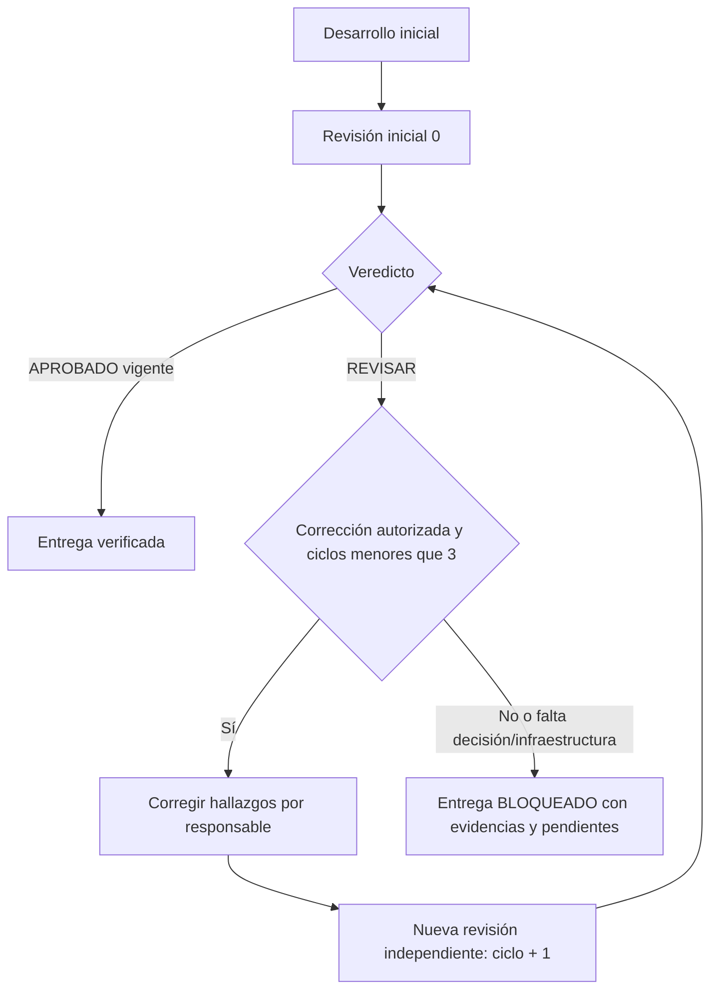

# Verificador y bucle de revisión de DemoAgentes

Definición del agente: [verificador.toml](../.codex/agents/verificador.toml).
El [orquestador](orquestador.md) coordina el bucle; los
[desarrolladores](agentes-desarrollo.md) corrigen. El verificador revisa el
cambio y sus criterios sin escribir código, pruebas, configuración o planes.
Los roles heredan los permisos de la sesión: estas fronteras son instrucciones
de comportamiento y no un aislamiento técnico del sistema de archivos.

## Contrato de revisión

El encargo incluye objetivo, criterios identificados, contrato vigente, archivos
atribuibles al cambio, estado previo de Git, número de revisión, hallazgos
anteriores, correcciones y comprobaciones permitidas o prohibidas. Debe delimitar
la versión revisada mediante commit y diff o hashes de los archivos relevantes;
un commit por sí solo no identifica los cambios aún sin guardar en Git.

La entrega comienza con `Veredicto: APROBADO` o `Veredicto: REVISAR` e incluye:

- Referencia de lo revisado y número de revisión.
- Cada criterio y su evidencia: cumplido, incumplido o pendiente.
- Comandos realmente ejecutados, resultado y comprobaciones no ejecutadas.
- Hallazgos con identificador estable, gravedad, archivo/símbolo, comportamiento
  esperado/observado, evidencia, reproducción cuando sea posible y responsable.
- Estado de hallazgos previos: resuelto, persistente o no comprobado.
- Limitaciones y su causa: defecto, cobertura, infraestructura o decisión.

`APROBADO` exige todos los criterios del encargo cubiertos y las comprobaciones
necesarias ejecutadas correctamente, sin hallazgos que impidan cumplirlos. No
equivale a aprobar funcionalidades fuera del encargo ni autoriza publicación.
Una revisión solicitada expresamente como estática solo puede aprobar ese
alcance y debe indicar que no acredita ejecución de la aplicación.

`REVISAR` significa que hay un defecto o evidencia necesaria pendiente. Una
infraestructura inaccesible no se presenta como defecto del código. Observaciones
de mejora fuera del contrato se separan de los impedimentos para aprobar.
Un resultado contradictorio o incompleto no equivale a una aprobación.

## Ciclos y estados

Para implementar se usa este flujo. Una consulta, un plan o una revisión sin
permiso de corregir termina en su entrega, sin activar desarrollo por rutina.



Se permite **una revisión inicial y hasta tres ciclos de corrección y nueva
verificación**, como máximo cuatro revisiones por encargo. El contador global
se inicia en cero, aumenta al iniciar cada corrección y no se reinicia por capa,
por cambiar de agente o por aparecer un hallazgo nuevo dentro del mismo encargo.
Cada ciclo puede contener correcciones de backend y frontend; solo participan
los responsables afectados. No son tres ciclos por desarrollador.

El orquestador mantiene los estados `DESARROLLO`, `VERIFICACION`, `CORRECCION`,
`APROBADO` y `BLOQUEADO`, junto con el contador y el dictamen del verificador.
`REVISAR` es un dictamen; `BLOQUEADO` es el estado de entrega del flujo. No se
confunden con estados de herramientas externas de objetivos o de GitHub Issues.

Ante `REVISAR`, devuelve hallazgos concretos, criterios y evidencias al responsable.
Recoge la corrección y solicita al verificador comprobar los hallazgos anteriores
y las regresiones relevantes. El verificador nunca se encarga de corregirse.
Se espera a que terminen los escritores antes de revisar, con recursos de pruebas
reservados. Una modificación de archivos relevantes invalida la aprobación
anterior: se computa como otra corrección y se revisa si quedan ciclos; de lo
contrario se entrega `BLOQUEADO`. No se reinicia el contador. Si la revisión
queda invalidada por cambios mientras se ejecuta, primero se estabilizan los
escritores; no se encadenan reintentos ilimitados sobre versiones inestables.

Tras la tercera corrección sin aprobación, o antes si faltan roles, una decisión
material, infraestructura imprescindible o progreso con evidencia nueva, se
entrega `BLOQUEADO`: causa, historial de ciclos, pendientes concretos y próximo
paso. No se hace una cuarta corrección automática, ni commit o publicación por
haber agotado el límite. Solo una nueva instrucción explícita del usuario puede
ampliar el límite o redefinir el encargo; el agente no lo aumenta por su cuenta.

## Comprobaciones y datos

Consultar los scripts antes de ejecutarlos y elegir los pertinentes al cambio:

| Ámbito | Script existente |
| --- | --- |
| Symfony, PHPStan y PHPUnit | `./scripts/test-backend.ps1` |
| Formato Angular, Vitest y compilación | `./scripts/test-frontend.ps1` |
| Recorrido Chromium | `./scripts/test-e2e.ps1` |

Las pruebas pueden generar cachés y artefactos ignorados y usar únicamente
`tasks_test.db` para PHPUnit y `tasks_e2e.db` con puertos 8001/4201 para E2E.
Comprobar configuración y disponibilidad antes de ejecutarlas; no reutilizar
servicios desconocidos ni detener procesos ajenos. No modificar `tasks.db` o
datos reales. No ejecutar suites simultáneas sobre los mismos recursos.

El verificador no añade tests ni usa formateadores con escritura, instalaciones,
actualizaciones o migraciones sobre datos reales. Si falta cobertura, devuelve
el hallazgo al desarrollador. Las comprobaciones de Doctrine que sean necesarias
se ejecutan en el entorno de prueba, sin actualizar el esquema de desarrollo.
Playwright MCP se utiliza cuando está disponible y es pertinente; su ausencia no
se oculta ni se confunde con una ejecución del runner Playwright Test.

En coordinación, el orquestador registra informes y ciclos en la bitácora; el
verificador devuelve su entrega sin escribir documentos comunes. En revisión
autónoma registra su resultado en la bitácora conforme al skill, sin crear un
informe adicional salvo petición o ruta asignada expresamente.

## Uso

```text
/prompts:orquestador Implementa <petición o plan> y coordina su revisión
con verificador y hasta tres ciclos de corrección. No hagas commit ni push.
```

```text
Usa el agente verificador para revisar <cambio> frente a <criterios>.
No corrijas archivos. Comprobaciones permitidas: <comandos/condiciones>.
```

Las definiciones deben estar expuestas por la sesión para seleccionarlas por
nombre. Si no se puede seleccionar un rol, se informa de ello; leer el TOML o
cargar sus instrucciones en una sesión genérica no acredita una invocación nativa.

## Validación de esta incorporación

Comprobado el 26 de noviembre de 2026: cinco TOML válidos, campos y nombres
coherentes, enlaces locales de las guías, conservación de fuentes funcionales y
sincronización del acceso directo con su copia personal. `git diff --check` no
mostró errores de espacios.

Se ensayaron las instrucciones literales mediante sesiones independientes de
Codex CLI, con ajuste temporal `developer_instructions` y permisos de solo
lectura. En una copia aislada se introdujo una regresión sintética en
`completedCount`: la revisión 0 devolvió `REVISAR` y `V-001`; el conductor del
ensayo restauró únicamente ese archivo de la copia y la revisión 1 devolvió
`APROBADO`, marcando `V-001` resuelto. Ambas revisiones limitaron su evidencia a
inspección estática y no escribieron archivos. La restauración la hizo el
conductor; este ensayo no acredita una corrección delegada al desarrollador.

Otra sesión ensayó seis decisiones conceptuales del orquestador: aprobación
inicial, primera corrección, tercera corrección, límite agotado, infraestructura
inaccesible y aprobación invalidada sin ciclos restantes. Coincidieron con los
estados y contadores esperados. Esto comprueba la interpretación de la política,
no la coordinación efectiva de herramientas y agentes.

Las evidencias están en `.runtime/verificador-bucle/`, ignorado por Git. No se
ejecutaron suites de aplicación, servicios o migraciones. La ejecución nativa
completa debe acreditarse separadamente con llamadas reales a roles y evidencias;
no se deduce de que los ficheros existan ni de cargar manualmente sus instrucciones.

Casos de ensayo: aprobación inicial; un defecto corregido; defectos en ambas
capas; tres correcciones insuficientes; infraestructura inaccesible; verificador
no disponible; petición de solo plan; revisión sin permiso de corregir; cambio
concurrente que invalida un dictamen. El resultado efectivo se registra en la
[bitácora](bitacora.md), distinguiendo revisión estática, ensayo de instrucciones
y prueba de selección nativa.
